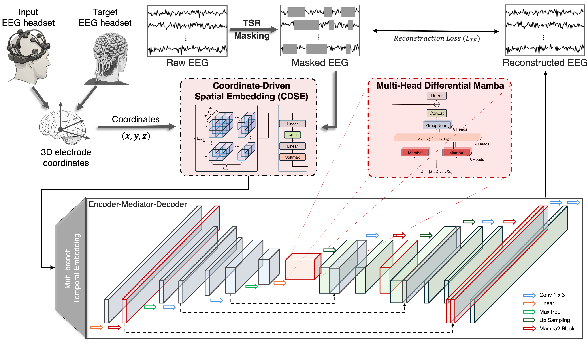
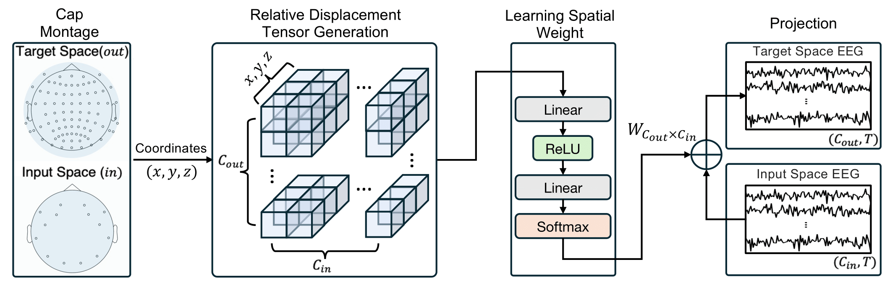

# SAMBA: Toward an EEG Foundation Model via Differential Mamba and Coordinate-Driven Spatial Embedding

**Accepted to the NeurReps 2026 Proceedings Track at NeurIPS 2026. The paper will appear in the Proceedings of Machine Learning Research (PMLR).**

**Last updated: October 2026**

**SAMBA** is a scalable self-supervised framework for long-sequence EEG foundation modeling. It integrates 3D coordinate-driven spatial embedding and differential Mamba modules to enable robust, efficient, and generalizable EEG representation learning across diverse recording configurations and cognitive tasks.

<p align="center">
  
</p>

---

## Abstract

Modeling long EEG sequences is critical for developing generalizable neural representations, particularly due to the high temporal resolution and extended durations often required to capture brain dynamics. While transformer-based models have shown success on short EEG segments, their quadratic complexity prevents effective scaling to long contexts. Additionally, the diversity in EEG montages and subject variability presents significant generalization challenges.

We introduce **SAMBA**, a self-supervised learning framework featuring a U-shaped encoder-decoder architecture built on the linear-time **Mamba** module. SAMBA incorporates:

1. **Temporal Semantic Random Masking** — to reconstruct semantically masked segments in long sequences;
2. **Multi-Head Differential Mamba** — to reduce redundancy and enhance salient temporal features;
3. **Coordinate-Driven Spatial Embedding (CDSE)** — to learn robust 3D spatial representations across heterogeneous EEG devices.

Evaluations across **13 EEG datasets** covering a range of tasks, montages, and sequence lengths demonstrate competitive or improved performance compared with recent state-of-the-art methods, while maintaining low memory usage and efficient inference. In addition, the learned spatial weights exhibit strong alignment with task-relevant neurophysiological regions, highlighting the interpretability of SAMBA.

<!-- > 📌 The code is available at: https://github.com/anon1280/SAMBA -->

---

## Learnable Spatial Embedding Visualization

The figure below illustrates the **Coordinate-Driven Spatial Embedding (CDSE)** module and its alignment with neurophysiological topology:

<p align="center">
  
</p>


<table align="center">
  <tr>
    <td align="center">
        <br/>
      <b>Eyes Close/Open</b><br/>
      Emphasizes the <u>frontal lobe</u>, consistent with alpha modulation during eye closure[1].
    </td>
    <td align="center">
      <br/>
      <b>Driver Distraction</b><br/>
      Highlights the <u>left temporal lobe</u>, associated with auditory processing (conversation during driving) and cognitive control under distraction[2].
    </td>
  </tr>
  <tr>
    <td align="center">
      <br/>
      <b>Workload Estimation</b><br/>
      Focuses on the <u>left frontal region</u>, linked to stress-induced workload processing[3].
    </td>
    <td align="center">
      <br/>
      <b>Abnormal Detection (Seizure)</b><br/>
      Shows <u>occipital dominance</u>, consistent with findings that occipital electrodes yield better performance for distinguishing abnormal EEG[4].
    </td>
  </tr>
  <tr>
    <td align="center" colspan="2">
      <br/>
      <b>Motor Imagery</b><br/>
      Localizes around the <u>motor cortex</u>, reflecting sensorimotor activity during imagery tasks[5].
    </td>
  </tr>
</table>

#### References
<!-- <div style="font-size: smaller"> -->
<sub>
[1] S. Hoffmann et al. The correction of eye blink artefacts in the EEG: a comparison of two prominent methods. PLOS ONE, 3(8):e3004, 2008.  <br/>
[2] G. Li et al. Drivers’ EEG responses to different distraction tasks. Auto. Innov., 6(1):20–31, 2023.  <br/>
[3] G. Berretz et al. Acute stress increases left hemispheric activity measured via changes in frontal alpha asymmetries. iScience, 25(2), 2022.  <br/>
[4] S. Lopez et al. Automated identification of abnormal adult EEGs. In Proc. IEEE SPMB, pp. 1–5, 2015.  <br/>
[5] J. Hong et al. A deep learning framework based on dynamic channel selection for early classification of left and right hand motor imagery tasks. In Proc. IEEE EMBC, pp. 3550–3553, 2022.  <br/>
</sub>
<!-- </div> -->

## Repository Structure
```plaintext
SAMBA/
├── Env-requirement/     # Environment configs with dated backups
├── Models/              # Model architecture implementations
├── utility/             # Supporting functions: data loading, masking, loss, evaluation
├── Figures/             # Diagrams and visualizations
├── Montage/             # EEG montage metadata for multiple devices
├── Main(SAMBA).py       # Main experiment entry point
└── README.md            # Project overview
```

## Citation

If you find this work useful, please cite the NeurReps 2026 proceedings paper:

```bibtex
@inproceedings{hong2026samba,
  title     = {{SAMBA}: Toward an {EEG} Foundation Model via Differential Mamba and Coordinate-Driven Spatial Embedding},
  author    = {Hong, Jiazhen and Mackellar, Geoffrey and Ghane, Soheila},
  booktitle = {NeurReps 2026: Symmetry and Geometry in Neural Representations},
  year      = {2026},
  note      = {Proceedings Track, to appear in Proceedings of Machine Learning Research}
}
```
